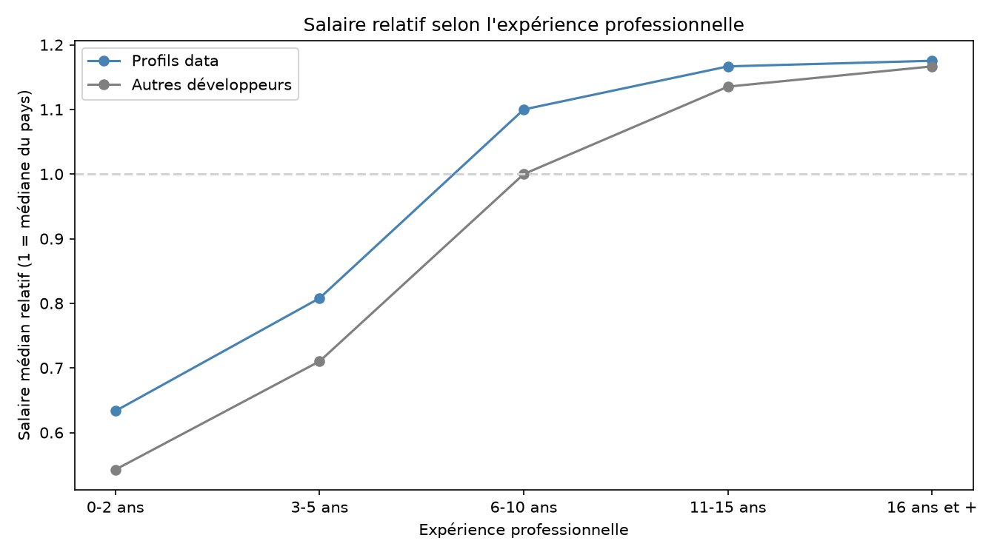
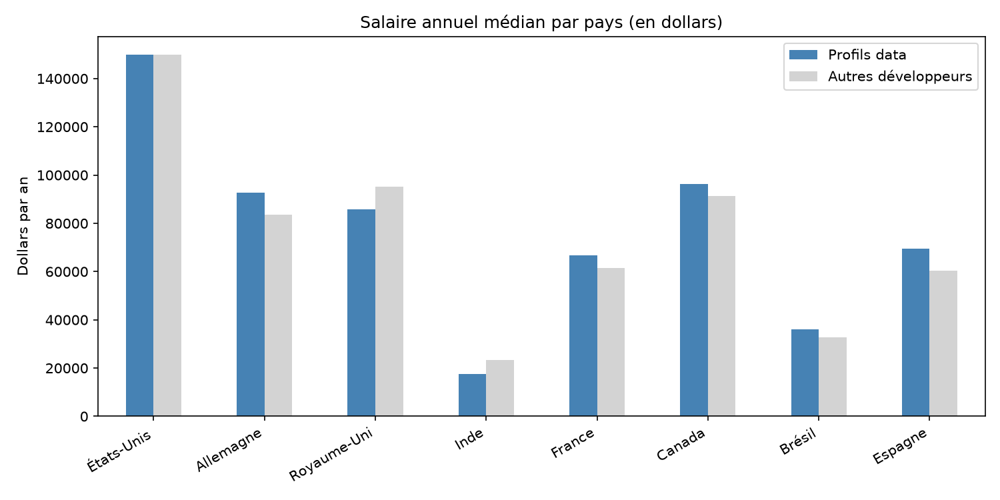
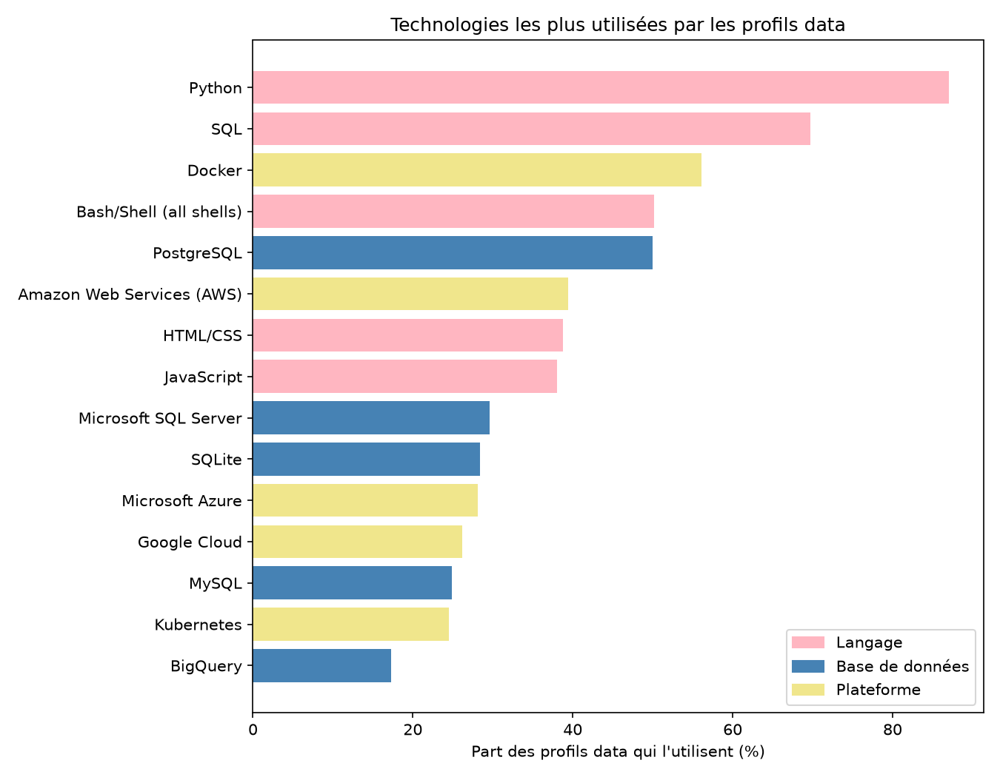
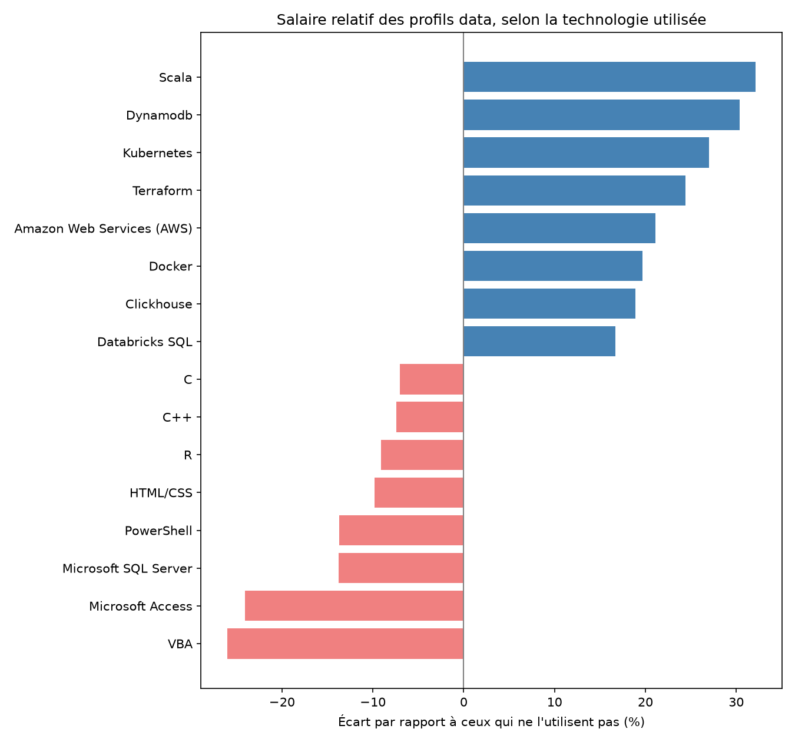
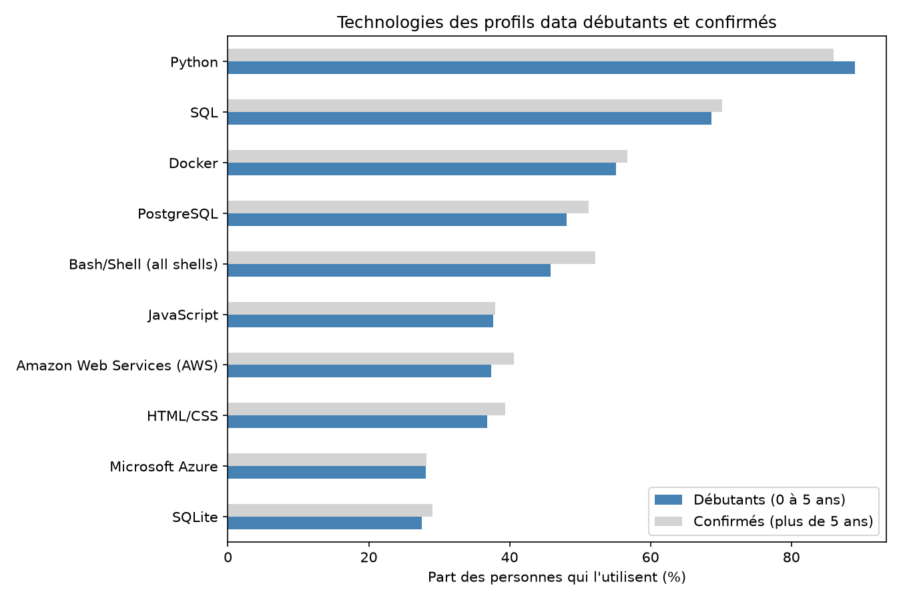

# Qu'est-ce qui fait varier le salaire des profils data ?

Pour savoir par où commencer en data, j’ai voulu répondre avec des données plutôt qu’avec des avis. J’ai analysé l’enquête Stack Overflow 2025 avec Python et SQL pour voir ce qui va avec un salaire plus élevé. Je suis étudiante en école d’ingénieur et je vise le métier de data scientist. Ce qui m’a surprise, c’est que les débutants utilisent presque les mêmes outils que les confirmés.

**Outils** Python, pandas, SQL (SQLite), matplotlib

## La question

Je me suis posé trois questions.

1. Les profils data sont-ils payés différemment des autres développeurs ?
2. Comment le salaire évolue-t-il avec l'expérience ?
3. Parmi les langages, bases de données et plateformes, lesquels sont associés à un salaire plus élevé chez les profils data ?

## Les données

Stack Overflow Developer Survey 2025, plus de 49 000 réponses de développeurs du monde entier.
https://survey.stackoverflow.co/

Les données sont sous licence ODbL, avec obligation de citer la source. Le fichier des réponses fait plus de 100 Mo, il n'est donc pas dans ce dépôt. Voir `data/LISEZMOI.txt` pour le télécharger.

## La méthode

1. **Nettoyage.** Je garde les personnes salariées avec un salaire annuel compris entre 5 000 et 500 000 dollars. Je note le nombre de personnes à chaque étape.
2. **Profils data.** Je regroupe les data scientists, data engineers, data or business analysts et AI/ML engineers.
3. **Salaire relatif.** Les salaires diffèrent énormément d'un pays à l'autre. Je divise donc chaque salaire par le salaire médian de son pays. Une valeur de 1,0 veut dire que la personne gagne la médiane de son pays. Je ne le calcule que pour les pays avec au moins 30 réponses.
4. **Base SQL.** Je charge trois tables dans SQLite (répondants, compétences, métiers) et j'écris cinq requêtes avec jointures, regroupements, filtres et un classement avec fonction de fenêtre.
5. **Statistiques.** Avec pandas, je calcule des médianes, plus fiables que les moyennes pour des salaires. Pour chaque technologie, je compare le salaire relatif médian des profils data qui l'utilisent à celui des autres profils data.
6. **Seuils.** Je ne compare une technologie que si au moins 30 personnes l'utilisent et au moins 30 ne l'utilisent pas.
7. **Mon analyse personnelle.** Je compare les technologies utilisées par les profils data débutants (0 à 5 ans d'expérience) et par les profils plus expérimentés, pour savoir quoi apprendre en priorité.

## Résultats

**La base.** Sur 49 191 réponses, 18 318 personnes salariées ont déclaré un salaire crédible, dont 1 104 profils data (6 %). On y trouve 405 data engineers, 281 data scientists, 279 ingénieurs IA/ML et 139 data ou business analysts.

**Le salaire selon l'expérience.** Le salaire augmente fortement avec l'expérience, pour tout le monde. À expérience égale, les profils data gagnent un peu plus que les autres développeurs par rapport à la médiane de leur pays, surtout en début de carrière (0,63 contre 0,54 entre 0 et 2 ans, 0,81 contre 0,71 entre 3 et 5 ans). L'écart se réduit ensuite et disparaît presque après 16 ans (1,18 contre 1,17). Sur l'ensemble de la base, les deux groupes ont pourtant le même salaire relatif médian (1,0). Cela s’explique sans doute par l’expérience, les profils data en ont moins (9 ans en médiane contre 12) ce qui compense leur avantage à expérience égale.



**Les pays.** En France, la médiane des profils data est d'environ 66 700 dollars par an, contre 61 500 pour les autres développeurs. Elle est plus basse au Royaume-Uni et en Inde, et identique aux États-Unis (150 000 dollars). Les échantillons par pays étant trop petits, je préfère donc ne pas surinterpréter ces chiffres.



**Les technologies les plus utilisées.** Python (87 %) et SQL (70 %) sont presque incontournables chez les profils data. Viennent ensuite Docker (56 %), Bash (50 %), PostgreSQL (50 %) et AWS (39 %).



**Les technologies associées à un salaire plus élevé.** Chez les profils data, ceux qui utilisent Scala (+32 %), DynamoDB (+30 %), Kubernetes (+27 %), Terraform (+24 %), AWS (+21 %) ou Docker (+20 %) ont un salaire relatif médian nettement plus élevé que ceux qui ne les utilisent pas. À l'inverse, VBA (-26 %), Microsoft Access (-24 %), SQL Server (-14 %) et PowerShell (-14 %) sont associés à des salaires plus bas. Python (+8 %) et SQL (-2 %) font peu de différence, parce que presque tout le monde les utilise.

Les premières technologies relèvent du cloud, de l'infrastructure et du traitement de données à grande échelle. Les secondes relèvent surtout de l'environnement Microsoft et Office. Il est probable que cela reflète le type de poste et d'entreprise plus que l'outil lui-même. L'expérience médiane de ceux qui utilisent ces technologies est comparable (autour de 9 à 10 ans pour la plupart), mais je ne l'ai pas comparée à celle des non-utilisateurs.



**Les débutants.** 345 profils data ont entre 0 et 5 ans d'expérience. Leurs technologies sont presque les mêmes que celles des profils confirmés, par exemple Python (89 % contre 86 %), SQL (69 % contre 70 %) et Docker (55 % contre 57 %). Il n'y a donc pas de boîte à outils spécifique aux débutants, les bases sont les mêmes dès le début.



**Ce que j'en retiens.** Ce projet m’a surtout appris à ne pas conclure trop vite. Les chiffres montrent des liens, pas des causes. Comme les débutants utilisent déjà les mêmes outils que les confirmés, je commence par Python, SQL et Docker, puis je teste un service cloud.

## Limites

- Les répondants se sont inscrits eux-mêmes à l'enquête, ils ne représentent pas tous les développeurs.
- Les salaires sont déclarés, pas vérifiés, puis convertis en dollars par Stack Overflow.
- Je décris des liens, pas des causes. Utiliser une technologie ne fait pas monter le salaire à lui seul. Les personnes qui l'utilisent peuvent aussi avoir plus d'expérience, c'est pourquoi j'affiche l'expérience médiane à côté de chaque écart.
- Je teste beaucoup de technologies à la fois, certains écarts peuvent donc être dus au hasard.
- Chaque répondant déclare un seul métier principal, certaines personnes qui font de la data peuvent donc être rangées ailleurs, par exemple en développeur back-end.
- Les profils analystes sont peu nombreux (139), les conclusions les concernent moins.
- Les groupes par pays sont petits, au moins 15 personnes par groupe.
- Le groupe des débutants est plus petit que celui des confirmés, ses pourcentages sont donc moins précis.
- Seules les personnes salariées sont retenues, pas les indépendants ni les étudiants.

## Lancer le projet

```
pip install -r requirements.txt
python analyse_salaires_data.py
```

Les graphiques sont enregistrés dans `images/` et les tableaux dans `resultats/`.

## Pistes pour aller plus loin

- Ajouter un tableau de bord Power BI sur les mêmes données.
- Refaire l'analyse avec l'édition 2026 quand le fichier détaillé sera disponible.

*Projet personnel de Maryam Ducasse*
